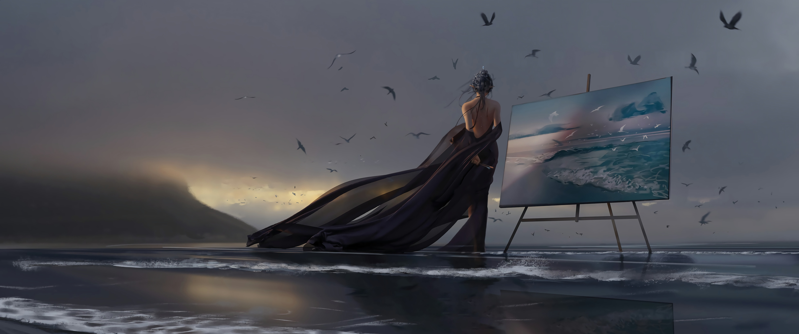

# Omarchy Queen Fengling Theme

Queen Fengling is a dark palette sampled from the *Queen Fengling* painting: a deep slate background from the wet shore and her dress, a misty grey-blue from the storm sky, a soft gold accent from the sunlight breaking over the hills, and teal and rose from the seascape on her easel. Gaps, rounded corners and animations match the Kawabi Neon theme (`gaps_in = 2`, `gaps_out = 2`, `rounding = 22`).

## Install

```bash
omarchy theme install https://github.com/Korgen-Jurai/omarchy-queen-fengling-theme.git
```

## What's included

- Terminal palette (`colors.toml`), which drives Alacritty, Kitty, Foot, Ghostty, btop, VS Code, Obsidian and more through Omarchy's built-in templates
- Hyprland borders, gaps, corners and animations (`hyprland.lua`)
- Wallpaper (`backgrounds/1-queen-fengling.jpg`)

## Wallpaper


